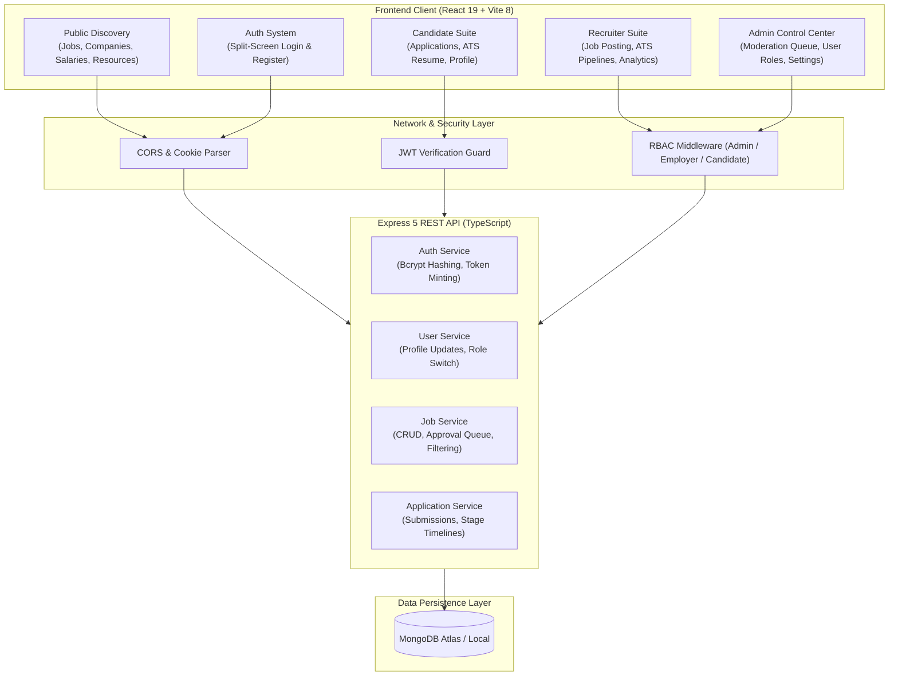

# 🚀 DevHire — Modern Developer Job & Hiring Platform

<div align="center">


[](https://react.dev/)
[](https://www.typescriptlang.org/)
[](https://vitejs.dev/)
[](https://tailwindcss.com/)
[](https://daisyui.com/)
[](https://nodejs.org/)
[](https://expressjs.com/)
[](https://www.mongodb.com/)
[](LICENSE)

**DevHire** is a full-stack, developer-first recruitment and engineering job discovery platform. Engineered specifically for software engineers, engineering managers, and modern high-growth tech companies, DevHire eliminates recruiter spam and opaque hiring through **radical salary transparency**, **skill-first stack matching**, **direct-to-team ATS applications**, and **dedicated role-based portals**.

[Explore Jobs](#-public-portal--features) • [System Architecture](#-system-architecture) • [Candidate Suite](#-candidate-suite) • [Recruiter Suite](#-recruiter--employer-suite) • [Admin Control Center](#-admin-control-center) • [Setup Guide](#-getting-started) • [API Reference](#-api-endpoints-overview)

</div>

---

## 🌟 Key Highlights & Architectural Strengths

- **Full-Stack MERN + TypeScript:** End-to-end type safety spanning MongoDB models, Express controllers, API contracts, and React 19 client components.
- **Role-Based Access Control (RBAC):** Three distinct platform experiences: **Candidate**, **Employer (Recruiter)**, and **Admin**.
- **Interactive Application Engine:** Candidates apply directly from job cards or modals; submissions persist in MongoDB with real-time candidate dashboard synchronization.
- **Master Admin Control Center:** Centralized telemetry aggregating user signups, job moderation queue with instant 1-click **Approve / Reject**, ATS pipeline conversion funnel, and server health.
- **Developer-Centric Authentication:** Split-screen authentication with visual role selector cards, real-time password matching validation, and 1-click quick test credential fills.
- **Consent-First Privacy & Compliance:** Fully GDPR/CCPA compliant privacy policy with interactive browser storage & cookie preference manager.
- **Modern Responsive Design System:** Tailwind CSS v4 paired with DaisyUI v5, dark/light themes, keyboard shortcuts (<kbd>/</kbd> to search), and buttery-smooth Lenis scrolling.

---

## 🏗️ System Architecture



---

## 🖥️ Public Portal & Features

| Page | Path | Key Functionality |
| :--- | :--- | :--- |
| **Landing Page** | `/` | Dynamic hero section, search bar, live featured jobs, trusted tech company carousel, and candidate testimonials. |
| **Job Search & Filters** | `/jobs` | Real-time search across titles, skills, and locations, workplace pills (*Remote, Hybrid, On-site*), category dropdowns, and instant **Apply Now Modal** trigger. |
| **Top Companies** | `/companies` | Tech company directory (Stripe, OpenAI, Vercel, Supabase) with tech stack tags, work models, and open role counters. |
| **Salary Guide** | `/salaries` | Interactive **Developer Salary Estimator Widget**, compensation benchmarks, demand indices, and Grid / Table view toggle. |
| **Resources & Playbooks**| `/resources` | Technical interview cheatsheets, ATS resume templates, and system design roadmaps. |
| **For Employers** | `/employers` | Recruitment landing page highlighting 12-day time-to-hire ROI, pre-screened developer profiles, and hiring plans. |
| **About Us** | `/about` | The Developer-First Manifesto, company mission, 18,500+ engineer community metrics, and dual-sided ecosystem breakdown. |
| **Contact Support** | `/contact` | Multi-channel support desk (candidate, employer, security triage) and interactive dispatch form. |
| **Privacy Policy** | `/privacy` | Comprehensive 9-section data protection & privacy compliance policy with sticky table of contents and zero-data-selling guarantee. |
| **Cookie Policy** | `/cookies` | Live interactive **Cookie & Local Storage Preference Manager** with instant save toggles and complete storage inventory. |

---

## 👨‍💻 Candidate Suite

A comprehensive career hub for software developers to manage applications, analyze resumes, and optimize recruiter visibility:

- **Dashboard Overview (`Overview.tsx`):** Real-time metrics (Total Applications, In Review, Interviewing, Offered), saved job counter, and recent activity log.
- **My Applications (`MyApplications.tsx`):** Real-time application tracking connected directly to MongoDB (`GET /api/applications/my-applications`). Displays status badges (`Submitted`, `Under Review`, `Interviewing`, `Offered`, `Not Selected`), stage progress timeline, notes, candidate info inspector, and 1-click withdrawal.
- **Interactive Application Modal (`ApplyJobModal.tsx`):** 1-click modal that autofills candidate info from auth session, accepts resume link, portfolio, GitHub, years of experience, and cover note, saving directly to MongoDB.
- **Developer Profile (`Profile.tsx`):** Verified developer profile with editable bio, headline, workplace & experience levels, connected GitHub/LinkedIn/Portfolio links, and real-time backend synchronization (`PATCH /api/users/:id`).
- **Saved Jobs (`SavedJobs.tsx`):** Bookmarked developer roles with 1-click Quick Apply action.
- **My Resume (`MyResume.tsx`):** Drag-and-drop resume upload zone (PDF/DOCX), automated ATS compatibility analyzer (90%+), and an **in-page embedded PDF document viewer** with instant download and replace.
- **Skills Manager (`Skills.tsx`):** Technical and soft skills manager with proficiency tiers (*Beginner*, *Intermediate*, *Advanced*, *Expert*), star ratings, category groupings, and quick-add suggestions.
- **Work Experience & Education (`Experience.tsx`, `Education.tsx`):** Career timeline with company names, roles, employment types, technologies used, achievements, and academic credentials manager.

---

## 🏢 Recruiter & Employer Suite

Equips hiring teams and technical recruiters with tools to source, evaluate, and hire software engineers:

- **Analytics Overview (`Overview.tsx`):**
  - **Application Inflow Graph:** Multi-bar chart with gradient pillars and Weekly/Monthly toggle to track applicant volume.
  - **ATS Pipeline Funnel Graph:** 4-stage conversion visualization from *Applied (100%)* to *Offer Extended (~12%)*.
  - **Tech Stack Distribution Graph:** Breakdown of candidate competencies (React, Node.js, TypeScript, Python, Go).
- **Post a Job (`PostJob.tsx`):** Multi-step job authoring form with salary bands, tech tags, experience level, workplace model, and live candidate preview modal connected to `POST /api/jobs`.
- **Manage Jobs (`ManageJobs.tsx`):** Centralized job dashboard with real-time search, filters, inline edit modal (`PATCH /api/jobs/:id`), status toggling, and deletion (`DELETE /api/jobs/:id`).
- **Company Branding (`YourProfile.tsx`):** Manage corporate bio, hiring locations, tech stacks, benefits, team size, website, and recruiter details.

---

## 🛡️ Admin Control Center

Comprehensive platform moderation, user governance, and infrastructure health:

- **Master Telemetry Overview (`Overview.tsx`):**
  - **4 Core Platform KPI Cards:** Total Users (Candidates vs Employers), Active Job Postings, Candidate Applications, and System Health.
  - **Administrative Command Center:** 1-click shortcut tiles to navigate instantly to any sub-module.
  - **Pending Moderation Queue:** Real-time queue of job listings submitted by recruiters awaiting approval with instant **1-Click Approve / Reject** actions.
  - **ATS Conversion Funnel:** Real-time pipeline visualizer.
  - **Live User & Application Feeds:** Real-time list of newly registered users and recent candidate applications.
- **User Governance (`UserManagement.tsx`):** Directory of all registered users with **instant inline role switching** (`ADMIN`, `EMPLOYER`, `CANDIDATE`), account activation/suspension toggles, and deletion.
- **Recruiter Directory (`RecruiterManagement.tsx`):** Directory of employer accounts with verification badges, registered emails, and live job counts.
- **Job Moderation Queue (`JobManagement.tsx`):** Full moderation table where administrators review pending job posts, inspect details, approve/reject listings, or remove obsolete posts.
- **Platform Configuration (`Settings.tsx`):** Maintenance mode toggles, signup restrictions, auto-approve job rules, quota limits, and security controls.

---

## 🛠️ Tech Stack & Dependencies

### Frontend
- **Framework:** React 19 (Strict Mode)
- **Language:** TypeScript 5
- **Build Tool:** Vite 8
- **Styling:** Tailwind CSS v4 + DaisyUI v5
- **Icons:** Lucide React
- **Animations:** Framer Motion
- **Smooth Scrolling:** Lenis Scroll
- **Routing:** React Router v7 (`react-router-dom`)
- **State & Networking:** React Context API + Typed Fetch API Client (`api.ts`)

### Backend
- **Runtime:** Node.js (v18+ LTS)
- **Framework:** Express.js 5 (TypeScript)
- **Database:** MongoDB via Mongoose ODM (v8)
- **Authentication:** JSON Web Tokens (JWT) + `bcryptjs` password hashing
- **Cookie Handling:** `cookie-parser`
- **CORS:** Configured with whitelist origins & credentials support
- **Development Tooling:** `ts-node-dev` with hot-reloading

---

## 📂 Project Structure

```text
Job-Portal/
├── backend/
│   ├── src/
│   │   ├── config/             # DB connection (connectDB), CORS, & env schema
│   │   ├── constants/          # Enums (Role: ADMIN, EMPLOYER, CANDIDATE)
│   │   ├── middlewares/        # authMiddleware, roleMiddleware, error/notFound
│   │   ├── modules/
│   │   │   ├── application/    # Model, service, controller, routes (/api/applications)
│   │   │   ├── auth/           # Login, register, JWT controllers & routes (/api/auth)
│   │   │   ├── job/            # Job CRUD, public listings & moderation (/api/jobs)
│   │   │   └── user/           # User profile & role switching service (/api/users)
│   │   ├── routes/             # Centralized Express router mounting (/api)
│   │   ├── types/              # Common & Express typing definitions
│   │   ├── utils/              # catchAsync, response helpers, JWT sign/verify
│   │   ├── app.ts              # Express middleware and app config
│   │   └── server.ts           # Server bootstrap and port listener
│   ├── .env                    # Backend environment secrets
│   ├── package.json
│   └── tsconfig.json
│
├── frontend/
│   ├── src/
│   │   ├── components/         # ApplyJobModal, Navbar, Footer, ProtectedRoute, PasswordInput
│   │   ├── context/            # AuthContext & role session management
│   │   ├── hooks/              # useTheme, useLenis custom hooks
│   │   ├── layouts/            # MainLayout (with Navbar & Footer)
│   │   ├── pages/
│   │   │   ├── dashboard/
│   │   │   │   ├── admin/      # Overview, UserManagement, JobManagement, RecruiterManagement, Settings
│   │   │   │   ├── candidate/  # MyApplications, MyResume, MyProfile, Skills, SavedJobs, Experience
│   │   │   │   └── recruiter/  # Overview, PostJob, ManageJobs, YourProfile, Applicants
│   │   │   ├── home/           # Landing page sections & CTA
│   │   │   ├── sections/       # Hero, CTA, Testimonials
│   │   │   ├── Jobs.tsx        # Searchable developer job board & filters
│   │   │   ├── Companies.tsx   # Tech company directory
│   │   │   ├── Salaries.tsx    # Interactive developer salary estimator widget
│   │   │   ├── Resources.tsx   # Engineering playbooks & guides
│   │   │   ├── Employers.tsx   # Recruitment landing page
│   │   │   ├── About.tsx       # Developer-first manifesto & platform story
│   │   │   ├── Contact.tsx     # Multi-channel support desk
│   │   │   ├── Privacy.tsx     # GDPR/CCPA privacy policy with table of contents
│   │   │   ├── Cookies.tsx     # Live storage & cookie preference manager
│   │   │   ├── Profile.tsx     # Verified user profile with live backend sync
│   │   │   ├── Login.tsx       # Modern split-screen authentication
│   │   │   ├── Register.tsx    # Split-screen registration with role tiles
│   │   │   └── Dashboard.tsx   # Dynamic role-based dashboard router
│   │   ├── services/           # Typed api() fetch client with JWT Bearer header
│   │   ├── App.tsx             # Route declarations
│   │   └── main.tsx            # DOM root mounting
│   ├── package.json
│   ├── vite.config.ts
│   └── tsconfig.json
│
└── README.md
```

---

## 🚀 Getting Started

### Prerequisites

Ensure you have the following installed on your system:
- **Node.js** (v18.0.0 or higher)
- **npm** or **yarn** / **pnpm**
- **MongoDB** (Local instance or free MongoDB Atlas cluster)
- **Git**

---

### 1. Clone the Repository

```bash
git clone https://github.com/MDSOBUJMADBOR/DevHire-Developer-Job-Portal.git
cd DevHire-Developer-Job-Portal
```

---

### 2. Backend Setup & Startup

Navigate to the `backend` directory and install dependencies:

```bash
cd backend
npm install
```

Create a `.env` file inside the `backend` folder:

```env
PORT=5000
MONGODB_URI=mongodb://127.0.0.1:27017/job-portal
JWT_SECRET=devhire_super_secret_jwt_key_2026
JWT_EXPIRES_IN=7d
CLIENT_URL=http://localhost:5173
```

Start the backend development server:

```bash
npm run dev
```

The backend API will start on: `http://localhost:5000`  
Health check endpoint: `http://localhost:5000/api/health`

---

### 3. Frontend Setup & Startup

Open a second terminal window, navigate to the `frontend` directory, and install dependencies:

```bash
cd frontend
npm install
```

Create a `.env` file inside the `frontend` folder:

```env
VITE_API_URL=http://localhost:5000/api
```

Start the Vite development server:

```bash
npm run dev
```

The application will be live at: `http://localhost:5173`

---

### 4. Production Build Verification

To verify that all TypeScript types, Vite assets, and DaisyUI components compile cleanly:

```bash
cd frontend
npm run build
```

---

## 📡 API Endpoints Overview

### Authentication & Users (`/api/auth`, `/api/users`)
| Method | Endpoint | Access | Purpose |
| :--- | :--- | :--- | :--- |
| `POST` | `/api/auth/register` | Public | Register new Candidate or Employer |
| `POST` | `/api/auth/login` | Public | Authenticate user and receive JWT bearer token |
| `GET` | `/api/users` | Admin | Fetch all registered platform users |
| `GET` | `/api/users/:id` | Authenticated | Fetch specific user details |
| `PATCH` | `/api/users/:id` | Authenticated | Update profile details, phone, or admin role switch |
| `DELETE`| `/api/users/:id` | Admin | Permanently delete user account |

### Jobs Management (`/api/jobs`)
| Method | Endpoint | Access | Purpose |
| :--- | :--- | :--- | :--- |
| `GET` | `/api/jobs` | Public | Fetch approved job listings (supports `q`, `category` filters) |
| `GET` | `/api/jobs/:id` | Public | Retrieve single job posting details |
| `POST` | `/api/jobs` | Employer / Admin | Post a new developer job listing |
| `PATCH` | `/api/jobs/:id` | Employer / Admin | Update job listing or moderate approval status |
| `DELETE`| `/api/jobs/:id` | Employer / Admin | Remove job posting |

### Applications & ATS Engine (`/api/applications`)
| Method | Endpoint | Access | Purpose |
| :--- | :--- | :--- | :--- |
| `POST` | `/api/applications` | Authenticated | Submit candidate application to MongoDB |
| `GET` | `/api/applications/my-applications` | Authenticated | Fetch candidate's own application history |
| `GET` | `/api/applications/all` | Employer / Admin | Fetch all incoming applications across postings |
| `GET` | `/api/applications/:id` | Authenticated | Retrieve detailed application dossier & timeline |
| `DELETE`| `/api/applications/:id` | Authenticated | Withdraw active candidate application |

---

## 🔒 Security, Compliance & Data Governance

- **Password Hashing:** Passwords are salted and hashed using `bcryptjs` with standard 10 salt rounds before storage.
- **Session Tokens:** Stateless cryptographically signed JSON Web Tokens (JWT) with configurable expiration (`7d`).
- **Role Enforcement:** Server-side `roleMiddleware` guards sensitive endpoints against unauthorized role escalation.
- **Privacy Compliance:** Universal GDPR and CCPA support including Right of Access and Right to Erasure (*Right to be Forgotten*).
- **Zero Ad Trackers:** Zero third-party advertising pixels (no Meta Pixel, no Google Ads tracking).

---

## 🤝 Contributing

Contributions, issues, and feature suggestions are always welcome!

1. Fork the Project
2. Create your Feature Branch (`git checkout -b feature/AmazingFeature`)
3. Commit your Changes (`git commit -m 'feat: Add some AmazingFeature'`)
4. Push to the Branch (`git push origin feature/AmazingFeature`)
5. Open a Pull Request targeting the `development` branch

---

## 📄 License

This project is licensed under the **MIT License** — see the [LICENSE](LICENSE) file for details.

---

## 👨‍💻 Author & Contact

**MD Sobuj Madbor**
- **GitHub:** [@MDSOBUJMADBOR](https://github.com/MDSOBUJMADBOR)
- **Repository:** [DevHire-Developer-Job-Portal](https://github.com/MDSOBUJMADBOR/DevHire-Developer-Job-Portal)
- **Portfolio:** [Visit Portfolio](https://md-sobuj-madbor-portflio.vercel.app)

<div align="center">
  <sub>Designed & Developed with ❤️ by <strong>MD Sobuj Madbor</strong> for the global software engineering community.</sub>
</div>
